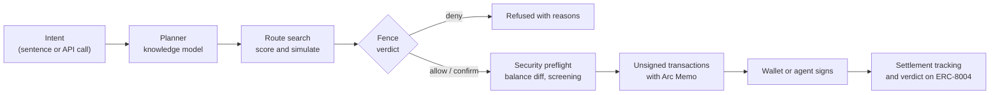

<h1 align="center">Lykia</h1>

<p align="center">
  <strong>The policy layer for money that agents and apps move on Arc Network.</strong>
</p>

<p align="center">
  <a href="https://github.com/furkan3152/Lykia/actions/workflows/ci.yml"></a>
  <a href="LICENSE"></a>
  
  
  
</p>

<p align="center">
  <a href="https://lykia-akdogan1.vercel.app">App</a> ·
  <a href="https://lykia-api-akdogan1.vercel.app/v1/reference">API reference</a> ·
  <a href="docs/platform/README.md">Developer docs</a> ·
  <a href="https://lykia-akdogan1.vercel.app/league">The League</a> ·
  <a href="https://lykia-akdogan1.vercel.app/mint">The Mint</a> ·
  <a href="https://lykia-akdogan1.vercel.app/stats">Stats</a>
</p>

---

Say the outcome. Lykia compiles it into a route across the protocols live on
Arc and Circle's rails (CCTP, Gateway, StableFX), checks every step against
a typed policy called the **Fence**, and hands the result to a wallet or an
agent to sign. The same engine is an API, SDKs, an MCP server and
embeddable components, so any team can add routing, policy checks and an
assistant to its own product.

Lykia is non-custodial: the server never holds keys and never signs.

| Pillar | In one line |
|---|---|
| Outcomes, not transactions | A sentence, a form or one API call becomes a scored, simulated route sent as one transaction with an Arc Memo. |
| Rules that hold | The Fence is checked before signing, compiled into a Circle Agent Wallet policy and enforced on chain; agents carry a Tag (ERC-8004) that pins it. |
| One engine for every builder | REST and SSE, MCP, TypeScript and Python SDKs, a CLI and components, all on the engine the app uses. |

Lykia's own products are the cities of **the League**: Lykia Pay (invoices,
payment links and payouts), Lykia Agents (budgeted agents with Fences and
Tags) and, coming, Lykia Perps. Each city is a real project built in **The
Mint**, the developer portal any builder uses, and can run on its own
subdomain with its own task-first shell ([docs/platform/city-domains.md](docs/platform/city-domains.md)).
The Lykia team runs the League and the platform from **Letoon**, a console
that only admin addresses can open.

The product story, the app's structure and open decisions are in
[docs/product.md](docs/product.md). Every flow is simulated on Arc mainnet in
[docs/flows.md](docs/flows.md).

## Contents

- [Features](#features)
- [How it works](#how-it-works)
- [Quick start](#quick-start)
- [Using the API](#using-the-api)
- [Packages](#packages)
- [Contracts](#contracts)
- [Security](#security)
- [Documentation](#documentation)
- [Contributing](#contributing)
- [License](#license)

## Features

**For users**

- **Plain-language intents.** "Convert 500 USDC to EURC and pay 200 EURC
  for invoice 7" becomes a checked, multi-step plan.
- **Route search.** Every capable venue is compared on net outcome after
  fees, gas, slippage and risk; the winner is simulated on chain before it
  is offered.
- **The Fence.** Caps per step, intent, day and week; recipient, venue and
  token lists; slippage, health factor and FX band limits; schedules; and a
  kill switch (the **Whistle**) that still lets value come home.
- **Conditional orders.** Limit, stop-loss, take-profit, TWAP and DCA
  orders on the `LykiaOrders` contract, executed by keepers.
- **Token checks.** Look-alike detection, proxy and privileged
  function analysis and a simulated transfer before a token is touched.

**For developers**

- **The Mint.** A builder's journey in seven steps at `/mint`: strike a
  project (a city), shape it in the Workshop, manage keys, usage, logs and
  webhooks, read the reference, and ask for a listing in the League
  (`POST /v1/projects/:id/league/request`; public listing at `GET /v1/league`).

- **Aggregator API.** Quote and build for transfer, swap, FX, bridge,
  deposit, withdraw, supply, borrow, repay and batches. Output as EOA
  transactions, smart-account calls or EIP-5792 `wallet_sendCalls`.
- **Protocol adapters.** Submit a `lykia.adapter/v1` manifest; after
  on-chain validation and review the protocol becomes routable without a
  redeploy.
- **Agents.** Sub-agents with strict-subset Fences and budgets, ERC-8004
  identities (**Tag**) and verifiable policy verdicts.
- **Platform.** Test and live keys, scopes, quotas, idempotency keys,
  signed webhooks with retries, request logs and an OpenAPI 3.1 document.
- **Integrations.** TypeScript and Python SDKs, a CLI, React components,
  web components, AI framework adapters and an MCP server.

**Built on Circle's products**

USDC, CCTP V2, Gateway, StableFX, Circle Wallets, the Compliance Engine and
the x402 facilitator are first-class execution paths. A Fence can be
compiled into a Circle Agent Wallet policy, so agents can run on a Circle
wallet with Lykia's checks on top. See [docs/circle](docs/circle/README.md).

## How it works



Every value-moving call carries an Arc Memo that links it to its plan, its
step and the Fence verdict digest. Approve, act and memo go out as one
transaction through `Multicall3From`, so the user stays `msg.sender`.

## Quick start

Requirements: Node.js 22.12 or newer and npm.

```sh
git clone https://github.com/furkan3152/Lykia.git
cd Lykia
npm ci
cp apps/api/.env.example apps/api/.env   # optional: add your own keys
npm run dev:api                          # http://localhost:3002
npm run dev:web                          # http://localhost:5176
```

Run the full check suite (build, tests, lint, typecheck) before opening a
pull request:

```sh
npm run verify
npm test -w @lykia/contracts
```

## Using the API

Get a quote for converting 100 USDC to EURC on Arc mainnet:

```sh
curl -X POST https://lykia-api-akdogan1.vercel.app/v1/aggregator/quote \
  -H 'content-type: application/json' \
  -d '{"tokenIn":"USDC","tokenOut":"EURC","amount":"100","taker":"0xYourAddress"}'
```

With the TypeScript SDK:

```ts
import { Lykia } from "@lykia/sdk";

const lykia = new Lykia({
  baseUrl: "https://lykia-api-akdogan1.vercel.app",
  apiKey: process.env.LYKIA_API_KEY,
});

const quote = await lykia.aggregator.swapQuote({
  tokenIn: "USDC",
  tokenOut: "EURC",
  amount: "100",
  taker: "0xYourAddress",
});
const build = await lykia.aggregator.build(quote.quoteId!);
// build.transactions are unsigned; sign them with your wallet.
```

More examples are in [examples/](examples) and the
[developer docs](docs/platform/README.md).

## Packages

| Package | Description |
|---|---|
| [`@lykia/core`](packages/core) | Zero-I/O specification: networks, contracts, tokens, venues, Fence, verdicts, Tag |
| [`@lykia/sdk`](packages/sdk) | Typed API client with modular entry points |
| [`@lykia/widget`](packages/widget) | React components and headless hooks |
| [`@lykia/embed`](packages/embed) | Web components for any page, from one script tag |
| [`@lykia/agent-tools`](packages/agent-tools) | Tool definitions and adapters for AI frameworks |
| [`@lykia/cli`](packages/cli) | Command-line client |
| [`lykia` (Python)](sdks/python) | Python SDK |
| [`@lykia/contracts`](packages/contracts) | Solidity contracts and tests |
| [`@lykia/api`](apps/api) | API service (Express) |
| [`@lykia/web`](apps/web) | Web application (React, Vite) |

## Contracts

Deployed on Arc mainnet (chain id 5042) directly from the owner's wallet:

| Contract | Address |
|---|---|
| `LykiaAccountFactory` | [`0x810e8db89f4c4e8fa814ed3ed0d636d3416dd7f9`](https://explorer.arc.io/address/0x810e8db89f4c4e8fa814ed3ed0d636d3416dd7f9) |
| `LykiaRouter` | [`0xc9c0ea4d22ddbef4504a634759fb78334efc5d18`](https://explorer.arc.io/address/0xc9c0ea4d22ddbef4504a634759fb78334efc5d18) |
| `LykiaOrders` | [`0xdcefebb3d449b7f8965c5f1ae3bba836f30ae6cc`](https://explorer.arc.io/address/0xdcefebb3d449b7f8965c5f1ae3bba836f30ae6cc) |

## Security

Lykia has not had a paid third-party audit. Until it does, every mainnet
move is capped at $1,000 per step and $5,000 per day per owner, above any
Fence. Moves that bring value home are never capped.

- Self-review (static analysis, fuzz and invariant tests):
  [docs/security/self-review.md](docs/security/self-review.md)
- Security layer: [docs/security/layer.md](docs/security/layer.md)
- Reporting a vulnerability: [SECURITY.md](SECURITY.md)

## Documentation

| Topic | Link |
|---|---|
| Product story and structure | [docs/product.md](docs/product.md) |
| Mainnet flow proofs | [docs/flows.md](docs/flows.md) |
| Developer platform | [docs/platform](docs/platform/README.md) |
| The League and city domains | [docs/platform/league.md](docs/platform/league.md), [docs/platform/city-domains.md](docs/platform/city-domains.md) |
| Brand and vocabulary | [docs/brand.md](docs/brand.md) |
| Fence specification | [docs/fence.md](docs/fence.md) |
| Agents and sub-agents | [docs/pack.md](docs/pack.md) |
| Agent identity (Tag) | [docs/tag.md](docs/tag.md) |
| Knowledge model and routing | [docs/knowledge.md](docs/knowledge.md) |
| Integrating a protocol | [docs/integrate-your-protocol.md](docs/integrate-your-protocol.md) |
| Circle integration | [docs/circle](docs/circle/README.md) |
| Fees | [docs/fees.md](docs/fees.md) |
| Hosting | [docs/hosting.md](docs/hosting.md) |

## Contributing

Contributions are welcome. Please read [CONTRIBUTING.md](CONTRIBUTING.md)
and the [Code of Conduct](CODE_OF_CONDUCT.md) first.

## License

Released under the [MIT License](LICENSE).

Built on Arc Network. Lykia is an independent project and is not affiliated
with or endorsed by Circle or Arc.
