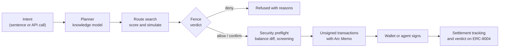

<h1 align="center">Lykia</h1>

<p align="center">
  <strong>The policy layer for money that agents and apps move on Arc Network.</strong>
</p>

<p align="center">
  <a href="https://github.com/furkan3152/Lykia/actions/workflows/ci.yml"></a>
  <a href="LICENSE"></a>
  
  
  
</p>

<p align="center">
  <a href="https://lykiaai.com">App</a> ·
  <a href="https://api.lykiaai.com/v1/reference">API reference</a> ·
  <a href="docs/platform/README.md">Developer docs</a> ·
  <a href="https://lykiaai.com/league">The League</a> ·
  <a href="https://lykiaai.com/forge">The Forge</a> ·
  <a href="https://lykiaai.com/stats">Stats</a>
</p>

---

Say the outcome. Lykia compiles it into a route across the protocols it can
route through on Arc and Circle's rails (CCTP, Gateway), checks every step against
a typed policy called the **Fence**, and hands the result to a wallet or an
agent to sign. The same engine is an API, SDKs, an MCP server and
embeddable components, so any team can add routing, policy checks and an
assistant to its own product.

Lykia never holds user keys. Plans come back unsigned for your wallet, your
passkey account or an agent session you created. Two optional server roles
do sign, each off unless the operator configures it: a gas-only keeper
(`LYKIA_KEEPER_PRIVATE_KEY`) that executes due conditional orders already
signed by their owners, and, opt-in with `LYKIA_CIRCLE_SERVER_WALLETS=true`,
Circle developer-controlled wallets that the server signs for with the
operator's entity secret (each wallet is bound to the address that created
it, and every payout from it passes the Fence and the beta cap first).

| Pillar | In one line |
|---|---|
| Outcomes, not transactions | A sentence, a form or one API call becomes a scored, simulated route sent as one transaction with an Arc Memo. |
| Rules that hold | The Fence is checked before every signature, enforced on chain for Lykia smart accounts, and its verdict digest rides in the Arc Memo; agents carry a Tag (ERC-8004) that pins it. |
| One engine for every builder | REST and SSE, MCP, TypeScript and Python SDKs, a CLI and components, all on the engine the app uses. |

The League hosts cities: Lykia's own products, each a real project built in
**The Forge**. The official cities (Lykia Pay for invoices, payment links and
payouts; Lykia Agents for budgeted agents with Fences and Tags; later Lykia
Perps) are being launched; until they are, `GET /v1/league` lists none. Each
city is a project built in The Forge, the developer portal any builder uses, and can run on its own
subdomain with its own task-first shell ([docs/platform/city-domains.md](docs/platform/city-domains.md)).
The Lykia team runs the League and the platform from **Letoon**, a console
that only admin addresses can open.

The product story, the app's structure and open decisions are in
[docs/product.md](docs/product.md). The money flows are simulated on Arc
mainnet in [docs/flows.md](docs/flows.md).

## USDC and Circle in Lykia

USDC is what Lykia moves, the unit it works in and what every step pays gas
with on Arc. Circle's rails carry it; Lykia adds the route and the rules.
One USDC through a Lykia step: USDC in the wallet, the Fence checks it in
USD, the route is simulated, approve, act and an Arc Memo go out as one
transaction with gas paid in USDC, it settles with deterministic finality,
and it can leave through CCTP or Gateway. The landing page draws the same
path, and [docs/circle/README.md](docs/circle/README.md) is the
authoritative version of this table.

| Primitive | From | Where Lykia uses it | File or endpoint |
|---|---|---|---|
| USDC | Circle | The token Lykia moves and the unit it works in: amounts, quotes and Fence caps are in USD, and routes are scored on what the owner ends up with. | `packages/core/src/assets.ts`, `apps/api/src/engine/search.ts` |
| USD caps | Lykia | The Fence checks every step in USD before signing. The mainnet beta cap is $1,000 per step and $5,000 per day, above any Fence. | `packages/core/src/fence.ts`, `LYKIA_BETA_CAP_USD` in `apps/api/src/config.ts` |
| eth_call | Arc | The winning route runs as one `eth_call` on Arc before it is offered. | `apps/api/src/engine/simulate.ts` |
| Multicall3From | Arc | From a wallet, approve, act and the Memo go out as one transaction with one signature. Lykia's smart account runs the same calls after its on-chain Fence check. | `apps/api/src/engine/calls.ts` |
| Arc Memo | Arc | From a wallet, the value-moving call of every step carries its intent id and the Fence verdict digest. | `apps/api/src/engine/calls.ts`, `packages/core/src/memo.ts` |
| Gas in USDC | Arc | Arc's gas token is USDC, so every Lykia step pays gas in USDC. Lykia's 1% fee is a transfer in the same transaction, in the token the step spends (a borrow pays in the borrowed token). | `packages/core/src/networks.ts`, `apps/api/src/engine/planner.ts`, `GET /v1/fees` |
| Deterministic finality | Arc | A step is final when its block is included; Lykia waits for no confirmations. | `packages/core/src/networks.ts` |
| CCTP V2 | Circle | Bridge steps burn USDC on Arc; after Circle's attestation it is minted on the destination, and Circle's Forwarding Service can submit that mint. | `apps/api/src/circle/cctp.ts`, `POST /v1/circle/cctp/forward` |
| Gateway | Circle | Gateway deposits and transfers: one unified USDC balance across chains. | `apps/api/src/circle/gateway.ts`, `GET /v1/circle/gateway/balance` |
| EURC | Circle | Circle's euro stablecoin. USDC to EURC conversions route on Arc and are checked against the Fence's FX band. | `packages/core/src/assets.ts`, `packages/core/src/fence.ts` |
| Compliance Engine | Circle | With `CIRCLE_API_KEY`, a send recipient it denies becomes a Fence deny. An unscreened recipient is reported, never treated as approved. | `apps/api/src/circle/compliance.ts`, `POST /v1/circle/screen` |
| Circle Wallets | Circle | Optional, off by default (`LYKIA_CIRCLE_SERVER_WALLETS=true`): developer-controlled SCA wallets on Arc, each bound to the address that created it. | `apps/api/src/circle/walletRegistry.ts`, `POST /v1/circle/wallets/agent` |
| Agent Wallet policy | Circle | A Fence exports as a Circle Agent Wallet spending policy. Lykia never applies it: the owner runs the returned Circle CLI commands. | `apps/api/src/circle/policy.ts`, `POST /v1/circle/policies/compile` |
| StableFX | Circle | RFQ endpoints (quote, trade, funding) for USDC and EURC, with Circle StableFX access. A reference quote beside the engine's, not a route. | `apps/api/src/circle/stablefx.ts`, `POST /v1/circle/stablefx/quote` |
| USYC Teller | Circle | Subscribe and redeem for wallets Circle has entitled; Lykia reads the entitlement first and refuses otherwise. | `apps/api/src/circle/usyc.ts`, `POST /v1/circle/usyc/prepare` |
| x402 facilitator | Circle | Settles Lykia's paid API routes in USDC; Circle's facilitator is the default. | `apps/api/src/x402/x402.ts`, `GET /.well-known/x402` |
| Agent Marketplace | Circle | Agents discover x402 services and pay them in USDC, inside their Fence caps. | `apps/api/src/circle/discovery.ts`, `POST /v1/circle/x402/prepare` |
| ERC-8004 | Arc | Agent identities (Tags) in the ERC-8004 registries on Arc, each pinning the hash of its Fence. | `apps/api/src/tag/tag.ts`, `packages/core/src/contracts.ts` |

## Contents

- [USDC and Circle in Lykia](#usdc-and-circle-in-lykia)
- [Features](#features)
- [How it works](#how-it-works)
- [Quick start](#quick-start)
- [Using the API](#using-the-api)
- [Packages](#packages)
- [Contracts](#contracts)
- [Security](#security)
- [Documentation](#documentation)
- [Contributing](#contributing)
- [License](#license)

## Features

**For users**

- **Plain-language intents.** "Convert 500 USDC to EURC and pay 200 EURC
  for invoice 7" becomes a checked, multi-step plan.
- **Route search.** Every capable venue is compared on net outcome after
  fees, gas, slippage and risk; the winner is simulated on chain before it
  is offered.
- **The Fence.** Caps per step, intent, day and week; recipient, venue and
  token lists; slippage, health factor and FX band limits; schedules; and a
  kill switch (the **Whistle**) that still lets value come home.
- **Conditional orders.** Limit, stop-loss, take-profit, TWAP and DCA
  orders on the `LykiaOrders` contract, executed by keepers.
- **Token checks.** Look-alike detection, proxy and privileged
  function analysis and a simulated transfer before a token is touched.

**For developers**

- **The Forge.** A builder's journey in seven steps at `/forge`: strike a
  project (a city), shape it in the Workshop, manage keys, usage, logs and
  webhooks, read the reference, and ask for a listing in the League
  (`POST /v1/projects/:id/league/request`; public listing at `GET /v1/league`).

- **Aggregator API.** Quote and build for transfer, swap, FX, bridge,
  deposit, withdraw, supply, borrow, repay and batches. Output as EOA
  transactions, smart-account calls or EIP-5792 `wallet_sendCalls`.
- **Protocol adapters.** Submit a `lykia.adapter/v1` manifest; after
  on-chain validation and review the protocol becomes routable without a
  redeploy.
- **Agents.** Sub-agents with strict-subset Fences and budgets, ERC-8004
  identities (**Tag**) and verifiable policy verdicts.
- **Platform.** Test and live keys, scopes, quotas, idempotency keys,
  signed webhooks with retries, request logs and an OpenAPI 3.1 document.
- **Integrations.** TypeScript and Python SDKs, a CLI, React components,
  web components, AI framework adapters and an MCP server.

**Built on Circle's products**

USDC is the token every step moves and pays gas with, and CCTP V2 and
Gateway are routes in the engine. Circle Wallets (optional, off by default),
the Compliance Engine, the Agent Wallet policy export, StableFX, the USYC
Teller, the x402 facilitator and the Agent Marketplace sit beside it. Where
each one lives in the code: [USDC and Circle in Lykia](#usdc-and-circle-in-lykia).

## How it works



Every value-moving call carries an Arc Memo that links it to its plan, its
step and the Fence verdict digest. Approve, act and memo go out as one
transaction through `Multicall3From`, so the user stays `msg.sender`.

## Quick start

Requirements: Node.js 22.12 or newer and npm.

```sh
git clone https://github.com/furkan3152/Lykia.git
cd Lykia
npm ci
cp apps/api/.env.example apps/api/.env   # optional: add your own keys
npm run dev:api                          # http://localhost:3002
npm run dev:web                          # http://localhost:5176
```

Run the full check suite (build, tests, lint, typecheck) before opening a
pull request:

```sh
npm run verify
npm test -w @lykia/contracts
```

## Using the API

Get a quote for converting 100 USDC to EURC on Arc mainnet:

```sh
curl -X POST https://api.lykiaai.com/v1/aggregator/quote \
  -H 'content-type: application/json' \
  -d '{"tokenIn":"USDC","tokenOut":"EURC","amount":"100","taker":"0xYourAddress"}'
```

With the TypeScript SDK:

```ts
import { Lykia } from "@lykia/sdk";

const lykia = new Lykia({
  baseUrl: "https://api.lykiaai.com",
  apiKey: process.env.LYKIA_API_KEY,
});

const quote = await lykia.aggregator.swapQuote({
  tokenIn: "USDC",
  tokenOut: "EURC",
  amount: "100",
  taker: "0xYourAddress",
});
const build = await lykia.aggregator.build(quote.quoteId!);
// build.transactions are unsigned; sign them with your wallet.
```

More examples are in [examples/](examples) and the
[developer docs](docs/platform/README.md).

## Packages

| Package | Description |
|---|---|
| [`@lykia/core`](packages/core) | Zero-I/O specification: networks, contracts, tokens, venues, Fence, verdicts, Tag |
| [`@lykia/sdk`](packages/sdk) | Typed API client with modular entry points |
| [`@lykia/widget`](packages/widget) | React components and headless hooks |
| [`@lykia/embed`](packages/embed) | Web components for any page, from one script tag |
| [`@lykia/agent-tools`](packages/agent-tools) | Tool definitions and adapters for AI frameworks |
| [`@lykia/cli`](packages/cli) | Command-line client |
| [`lykia` (Python)](sdks/python) | Python SDK |
| [`@lykia/contracts`](packages/contracts) | Solidity contracts and tests |
| [`@lykia/api`](apps/api) | API service (Express) |
| [`@lykia/web`](apps/web) | Web application (React, Vite) |

## Contracts

Deployed on Arc mainnet (chain id 5042) directly from the owner's wallet:

| Contract | Address |
|---|---|
| `LykiaAccountFactory` | [`0x810e8db89f4c4e8fa814ed3ed0d636d3416dd7f9`](https://explorer.arc.io/address/0x810e8db89f4c4e8fa814ed3ed0d636d3416dd7f9) |
| `LykiaRouter` | [`0xc9c0ea4d22ddbef4504a634759fb78334efc5d18`](https://explorer.arc.io/address/0xc9c0ea4d22ddbef4504a634759fb78334efc5d18) |
| `LykiaOrders` | [`0xdcefebb3d449b7f8965c5f1ae3bba836f30ae6cc`](https://explorer.arc.io/address/0xdcefebb3d449b7f8965c5f1ae3bba836f30ae6cc) |

## Security

Lykia has not had a paid third-party audit. Until it does, every mainnet
move is capped at $1,000 per step and $5,000 per day per owner, above any
Fence. Moves that bring value home are never capped.

- Self-review (static analysis, fuzz and invariant tests):
  [docs/security/self-review.md](docs/security/self-review.md)
- Security layer: [docs/security/layer.md](docs/security/layer.md)
- Reporting a vulnerability: [SECURITY.md](SECURITY.md)

## Documentation

| Topic | Link |
|---|---|
| Product story and structure | [docs/product.md](docs/product.md) |
| Mainnet flow proofs | [docs/flows.md](docs/flows.md) |
| Developer platform | [docs/platform](docs/platform/README.md) |
| The League and city domains | [docs/platform/league.md](docs/platform/league.md), [docs/platform/city-domains.md](docs/platform/city-domains.md) |
| Brand and vocabulary | [docs/brand.md](docs/brand.md) |
| Fence specification | [docs/fence.md](docs/fence.md) |
| Agents and sub-agents | [docs/pack.md](docs/pack.md) |
| Agent identity (Tag) | [docs/tag.md](docs/tag.md) |
| Knowledge model and routing | [docs/knowledge.md](docs/knowledge.md) |
| Integrating a protocol | [docs/integrate-your-protocol.md](docs/integrate-your-protocol.md) |
| Circle integration | [docs/circle](docs/circle/README.md) |
| Fees | [docs/fees.md](docs/fees.md) |
| Hosting | [docs/hosting.md](docs/hosting.md) |

## Contributing

Contributions are welcome. Please read [CONTRIBUTING.md](CONTRIBUTING.md)
and the [Code of Conduct](CODE_OF_CONDUCT.md) first.

## License

Released under the [MIT License](LICENSE).

Built on Arc Network. Lykia is an independent project and is not affiliated
with or endorsed by Circle or Arc.
