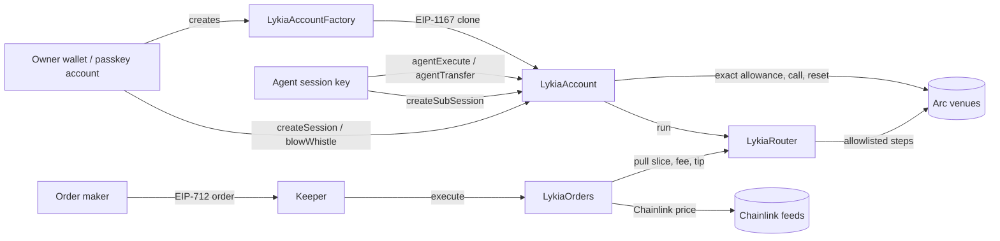

# Audit pack

Lykia's contracts are **not audited** by a paid firm: Lykia is a one-person, unfunded project. This pack supports self-review and community review (`docs/security/self-review.md`, `docs/security/help-us-review.md`): scope, architecture, trust assumptions, invariants with the tests that cover them, known limitations, the threat model of the off-chain parts, deployment and keys, and a readiness checklist. The mainnet beta caps exist because there is no audit.

## Scope

| Contract | Path | Lines | Status |
|---|---|---|---|
| `LykiaAccount` | `packages/contracts/contracts/LykiaAccount.sol` | 746 | Implementation deployed with the factory |
| `LykiaAccountFactory` | `packages/contracts/contracts/LykiaAccountFactory.sol` | 39 | Arc mainnet `0x810e8db89f4c4e8fa814ed3ed0d636d3416dd7f9` |
| `LykiaRouter` | `packages/contracts/contracts/LykiaRouter.sol` | 223 | Arc mainnet `0xc9c0ea4d22ddbef4504a634759fb78334efc5d18` |
| `LykiaOrders` | `packages/contracts/contracts/orders/LykiaOrders.sol` | 299 | Not deployed yet |
| `PracticeVault`, `PracticeSwap`, `PracticeLending` | `packages/contracts/contracts/practice/` | 329 | Testnet only, never for real value |
| `LykiaClQuoter` | `packages/contracts/contracts/quoters/LykiaClQuoter.sol` | 43 | Never deployed; placed by `eth_call` state override for quotes |
| `LykiaTimelock` | `packages/contracts/contracts/governance/LykiaTimelock.sol` | 17 | OpenZeppelin TimelockController for admin actions; not deployed (see `docs/security/ownership.md`) |

Out of scope for the contract audit but in scope for the threat model below: the planner, the Fence evaluator, the fee binding and submit verification in `apps/api/src/engine/` and `packages/core/src/`.

Toolchain: Hardhat 2.29.1, OpenZeppelin 5.6.1, Solidity 0.8.x targeting Cancun opcodes, optimizer 200 runs. Build and test: `npm run build -w @lykia/contracts`, `npm test -w @lykia/contracts`.

Deployment: both mainnet contracts were created by plain contract-creation transactions from the owner wallet `0x8c5281055b197443ff01dbbdfbf29fd63946ca1e` (blocks 29017527 and 29017551). The owner console and the admin registry compared deployed runtime code with the artifacts, ignoring immutables.

## Architecture



Off chain, for every plan:

```
intent ──► planner (quotes, routing) ──► Fence evaluation ──► verdict + digest
                                                         │
                         unsigned batch: approve + fee + action + memo (Multicall3From)
                                                         │
                       owner / passkey / session signs ──► Arc ──► submit(hash)
                                                         │
                               receipt verified against the binding hash
```

## Trust assumptions

- The owner key controls its account fully and can always act directly, including during a Whistle.
- The guardian can blow the Whistle but cannot release it or move funds.
- Session keys are untrusted beyond their session limits.
- `LykiaRouter`'s owner manages the venue allowlist and pause. A malicious venue on the allowlist is bounded by per-step and final floors but can still waste a step.
- `LykiaOrders`' owner can change the fee only up to `MAX_FEE_BPS` and never above the maker's signed `maxFeeBps`, can change the fee recipient and can pause. It cannot move a maker's funds.
- Chainlink feeds on Arc are trusted for trigger conditions, bounded by each order's `maxOracleAge`.
- Arc's native USDC (18 decimals) and its ERC-20 face (6 decimals) read one balance. Accounts must be created with `nativeUsdc` set to the face.

## Invariants and the tests that cover them

| Invariant | Test (`packages/contracts/test/`) |
|---|---|
| An account is initialised once, by the factory only | `account.test.cjs` · "is initialized once, by the factory only" |
| Only the owner executes and withdraws | `account.test.cjs` · "lets the owner execute and withdraw, nobody else" |
| An agent spends only through allowlisted calls with exact allowances reset to zero | "runs an allowlisted call, charges what left, resets the allowance…", "an exact allowance stops a greedy venue", "refuses strangers, unlisted calls and unlisted spend tokens" |
| Outputs return to the account | "forces outputs back to the account (receiver words)" |
| Per-call, rolling 24 h and lifetime caps hold, including at midnight | "enforces per-call, rolling 24 h and lifetime caps", "never lets an agent spend twice its daily cap around midnight UTC", "bounds every 24 h window when spends are spread across buckets" |
| Native USDC is charged against the ERC-20 face on Arc | "on Arc, charges native spends to the USDC face, rounded up to 6 decimals" |
| Agent transfers go only to allowlisted recipients or the owner | "pays allowlisted recipients and the owner, nobody else" |
| The Whistle stops everything except homeward moves; only the owner releases it | "stops everything but homeward moves; only the owner releases it" |
| A sub-session fits inside its parent; spending is charged up the chain; revoking a parent revokes descendants | "refuses every limit that does not fit inside the parent", "carves budgets from what the parent has left", "charges the whole chain…", "revoking a parent kills every descendant…", "stops at the maximum depth" |
| Session signatures cannot be replayed or used on another account | "a relayer submits a session-signed call; replays and forgeries fail", "a signature for one account does not work on another" |
| No re-entrancy through venues | "a venue cannot re-enter the account mid-call" (account), "cannot be re-entered by a venue" (router), "cannot be re-entered through a venue" (orders) |
| The factory's address commits to every setting | `factory.test.cjs` · "deploys at the predicted address, once, with the settings in the address" |
| The router floors outputs, never sweeps pre-existing balances, refuses value-moving selectors | `router.test.cjs` · "enforces step and final floors", "never sweeps tokens that were already sitting in the router", "refuses unknown venues, value-moving selectors…" |
| The router's integrator fee is capped | "takes a capped integrator fee from the final output" |
| Orders execute only when the trigger holds with a fresh price | `orders.test.cjs` · "refuses an unmet trigger and a stale price" |
| Orders keep the maker whole and bound the fee and tip | "keeps the maker whole…", "bounds the keeper tip and the fee" |
| Only the maker cancels; nonce floors, start and deadline hold | "lets only the maker cancel, honours nonce floors, start and deadline" |
| Orders route only through allowlisted venues | "only routes through the router's allowlisted venues" |
| The deploy plan creates each contract from the owner's wallet with matching code | `deployplan.test.cjs` |

## Known limitations

From `packages/contracts/SECURITY.md`:

- Daily caps use five 6-hour buckets, so a spend keeps counting for up to 30 hours.
- Receiver checks cover static ABI words only. Recipients inside dynamic data (including `LykiaRouter`'s `Intent.recipient`) are not checked on chain, which is why Uniswap v4 and Aerodrome are excluded from on-chain session rules.
- A token without a session limit can leave if the owner left a standing approval to an allowlisted venue.
- Allowlisting a general-purpose contract hands its power to the agent.
- The homeward lane covers only calls marked `homeward`, and a Whistle does not lift caps.
- Practice venues are owner-controlled stand-ins.
- Arc's public RPC returns zeros for `eth_getStorageAt`, so fork tests see code but not state.

## Threat model for the off-chain parts

| Threat | Mitigation | Where |
|---|---|---|
| The server is compromised | The server never holds owner or agent keys; for owner wallets it can only propose. On-chain sessions bound what agents can do. Exceptions, both opt-in: the gas-only keeper key (submits orders their owners signed) and, with `LYKIA_CIRCLE_SERVER_WALLETS=true`, the Circle entity secret, which controls the developer-controlled wallets created through the server | `apps/api` design; `LykiaAccount` |
| A submitted transaction differs from the prepared one | Submit re-derives the outcome from the receipt and refuses a mismatch with the binding hash (`BINDING_MISMATCH`), including when the fee call is missing | `apps/api/src/engine/service.ts`, `apps/api/src/engine/userop.ts` |
| A transaction hash is reused for another step | References are claimed once, globally | `apps/api/src/engine/service.ts` |
| A missing fact lets a risky plan through | The Fence denies when a rule needs a fact it lacks; unpriced is never zero | `packages/core/src/fenceEvaluate.ts` |
| Prompt injection steers the model-based orchestrator | Tool outputs are treated as data; agents can only propose; loosening a Fence needs the owner's signature | `apps/api/src/agents/` |
| A sub-agent escapes its parent | Strict-subset check per Fence field and carved budgets off chain; sub-sessions on chain | `packages/core/src/pack.ts`; `LykiaAccount` |
| Server-side request forgery through user URLs (Tag cards, webhooks, x402) | DNS pinned at connect time, private ranges refused, no redirects, size caps | `apps/api/src/http/pinnedFetch.ts` |
| Duplicate writes on retries | `Idempotency-Key` honoured on intents, prepare, submit and Pack writes | `apps/api/src/http/idempotency.ts` |
| Smart-account signatures | SIWE accepts ERC-1271 and ERC-6492 through viem on Arc | `apps/api/src/platform/` |
| Fee rounding abuse | Rounded up by at most one base unit, covered by tests | `packages/core/src/fee.ts`, `apps/api/src/__tests__/fee.test.ts` |

## Deployment and admin keys

| Role | Address or holder | Powers |
|---|---|---|
| Contract owner (factory, router) | `0x8c5281055b197443ff01dbbdfbf29fd63946ca1e` | Router venue allowlist and pause; future `LykiaOrders` fee within bounds, fee recipient, pause |
| Protocol fee recipient | `LYKIA_FEE_RECIPIENT` (default the owner address) | Receives the 1% fee |
| API admin | `LYKIA_ADMIN_ADDRESSES` | Owner console: deployment records, feature flags, Circle setup |
| Keeper | `LYKIA_KEEPER_PRIVATE_KEY` (optional) | Pays gas to execute orders; cannot move maker funds beyond the signed order |
| Tag guard | `LYKIA_GUARD_ADDRESS` (optional) | Responds to ERC-8354 validation requests |

Before larger amounts: move the owner role to a 2-of-3 Safe behind `LykiaTimelock` (`docs/security/ownership.md`) and keep the fee recipient separate from the signer keys.

## Readiness checklist

- [ ] Freeze the commit to audit and tag it.
- [ ] Share this pack, `packages/contracts/README.md` and `SECURITY.md`.
- [ ] Provide the test suite and coverage (`npm test -w @lykia/contracts`).
- [ ] Document every external call target the router and orders may allowlist on mainnet.
- [ ] Move ownership to a 2-of-3 Safe behind `LykiaTimelock` (`docs/security/ownership.md`); record the Safe and timelock.
- [ ] Keep the mainnet beta caps on: there is no paid audit.
- [ ] Publish the self-review (`docs/security/self-review.md`) and community findings with fixes.

## Disclosure policy

There is no paid bug bounty: Lykia is a one-person, unfunded project.
Reports follow the free responsible-disclosure policy in `SECURITY.md`
(private GitHub report, public credit). The community review call is
`docs/security/help-us-review.md`; the self-review with every Slither and
Mythril finding is `docs/security/self-review.md`.

## New surfaces (2026-11)

| Surface | Code | What to check | Tests |
|---|---|---|---|
| Fence -> Circle wallet policy compiler | `apps/api/src/circle/policy.ts`, `POST /v1/circle/policies/compile` | No mapping may produce a Circle policy looser than the Fence or the beta cap; tiers stay monotonic; rules Circle cannot enforce are reported as Lykia-only | `apps/api/src/__tests__/circle-stack.test.ts` |
| Policy apply | `POST /v1/circle/policies/apply` | Never applies on its own; returns owner commands (OTP stays with the owner) | same |
| Circle execution providers | `apps/api/src/circle/providers.ts` | Providers run only after the Fence; builds go through simulation and the security layer in the aggregator | same |
| x402 facilitator seller proof | `apps/api/src/circle/sellerProof.ts`, `apps/api/src/x402/x402.ts` | Proof signed by a Circle wallet through Circle's API; never a local key; failure sends no header | same |
| Agent Marketplace consumer | `GET /v1/circle/marketplace/services`, `POST /v1/circle/x402/prepare` | Price and payee go through the Fence as a transfer; SSRF guard on resources | `circle.test.ts` |
| Mandate drafts | `apps/api/src/circle/mandates.ts` | Drafts only, status pending; verdicts unchanged | `circle-stack.test.ts` |
| Fee schedule | `packages/core/src/fee.ts` (`feeBpsFor`), `apps/api/src/engine/planner.ts` | Exempt kinds stay free; unset schedule = base fee; values capped at 300 bps | `circle-stack.test.ts` |
| Public stats | `GET /v1/stats` | Aggregates only, no user addresses | `circle-stack.test.ts` |
| Ownership hardening | `LykiaTimelock.sol`, `scripts/ownership-plan.cjs`, `GET /v1/admin/ownership` | Two-step transfer, delay, no timelock admin | `governance.test.cjs` |
| Invariants | `test/invariants.test.cjs` | Caps, rolling window, sub-session charging, Whistle, revocation vs a reference model | `invariants.test.cjs` |
